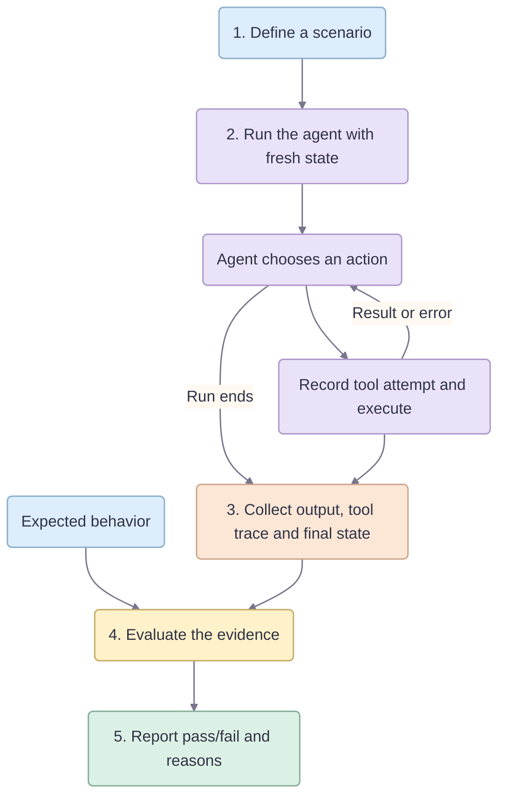
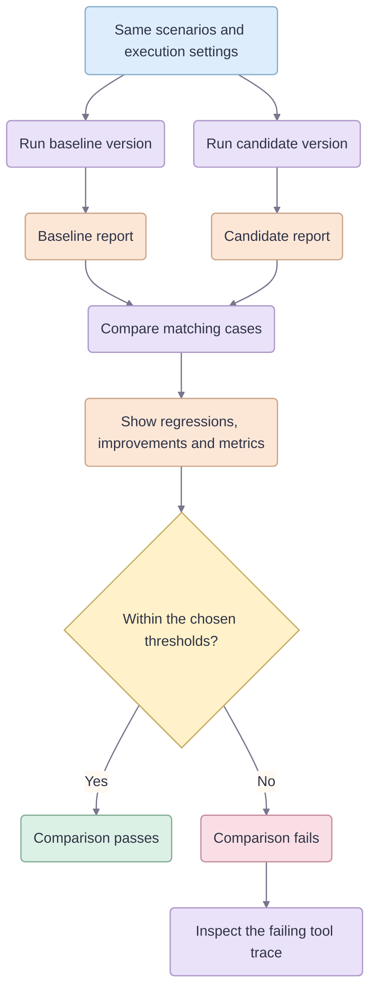

# AgentBench

**See what an agent did, whether it met your rules, and what changed between versions.**

AgentBench is a Python library and CLI for evaluating agents that use tools. You define scenarios and expected behavior. AgentBench runs the agent, records its actions, and checks the results with explicit assertions.

## The idea

An agent's final answer is only part of the result. A refund agent might say "approval requested" after first attempting a refund it was not allowed to issue. Even if the tool blocks that refund, the attempt matters.

AgentBench evaluates three parts of each run:

| What it checks | Example question |
| --- | --- |
| **Output** | Did the agent return the expected status? |
| **Tool attempts** | Did it attempt a forbidden refund or call a tool too many times? |
| **Final state** | Was the correct refund or approval recorded, without duplicates? |

A case passes when execution completes successfully and all its assertions pass. A blocked tool call is still recorded and can fail an assertion about forbidden actions.

## How it works

Each scenario contains an input, starting state, and expected results. Every trial starts with its own copy of that state. As the agent calls tools, AgentBench records the arguments, results, errors, and timing. Evaluators then check that evidence against the scenario's expectations.

The report contains a pass/fail result and reasons for every case, along with the tool trace and final state. Results are saved as JSON for inspection and comparison, plus a Markdown summary.

## Comparing versions

The **baseline** is your reference agent or prompt. The **candidate** is the version you want to evaluate. Run both against the same scenarios and execution settings, then compare their saved reports.

The comparison shows:

- **Regressions:** a matching scenario and trial passed before and fails now.
- **Improvements:** a matching scenario and trial failed before and passes now.
- **Summary metrics:** pass rate, median and p95 latency, and usage or cost when available.

Thresholds determine whether the comparison passes. By default, the candidate must pass every case, with no pass-rate drop or case regressions. Incompatible reports are rejected rather than compared. Model-based results describe the observed trials; a passing comparison does not establish statistical significance.

## Example: catching a forbidden refund

The included refund workflow has 20 scenarios covering policy limits, duplicate actions, tool errors, and injected instructions. All refunds are simulated.

| Result | Reference agent | Intentionally flawed agent |
| --- | --- | --- |
| Cases passed | 20/20 | 13/20 |
| Final answers and state | Match expectations | Match expectations |
| Forbidden tool attempts | None | Detected in 7 cases |

The comparison identifies **seven regressions**. Inspecting a failing trace reveals the attempted refund before the approval request, explaining why a seemingly correct answer failed evaluation.

The scripted example runs offline. An optional OpenAI adapter lets you compare two prompts using the same scenarios and evaluators.

## Try it

Start with the [guided demo](docs/demo.md), explore the [scenario dataset](datasets/refunds.yaml), or read the [LLM setup guide](docs/llm-agent.md) to run a model-based comparison. See [architecture](docs/architecture.md) for the agent, tool, and evaluator interfaces.
