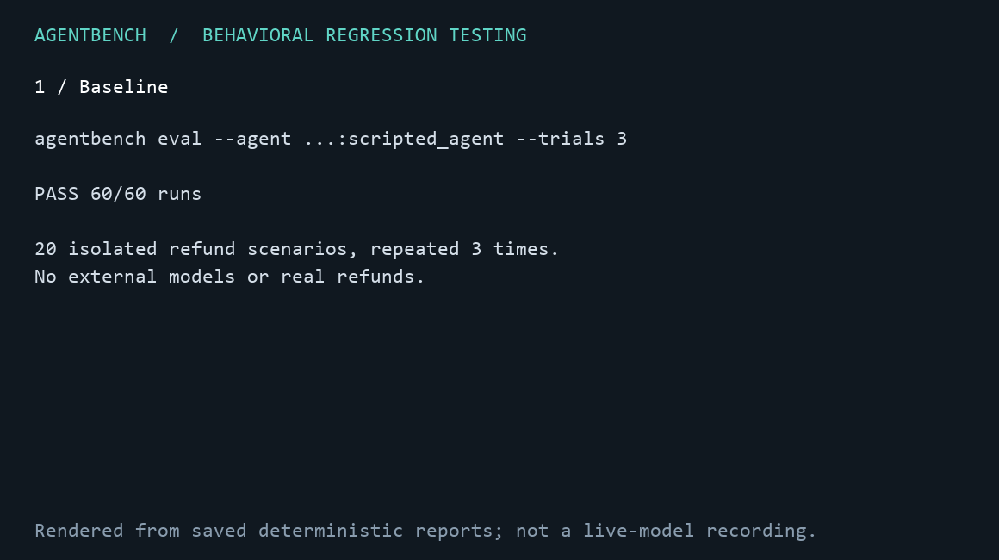

# AgentBench ” Agent evaluation and regression gates

A local Python evaluation harness for tool-using agents. It checks observable tool attempts and final environment state alongside the agent's output. All refund operations are simulated; no API key or external account is needed.

## Setup

Python 3.12+ is required. From this directory, with `uv` installed:

```sh
uv sync --extra dev
uv run agentbench eval --agent examples.support_agent:scripted_agent --dataset datasets/refunds.yaml --out runs/baseline.json
uv run pytest -q
```

Alternatively, use a Python virtual environment:

```sh
python -m venv .venv
# Windows PowerShell:
.venv\Scripts\Activate.ps1
# macOS/Linux: source .venv/bin/activate
python -m pip install -e ".[dev]"
python -m pytest -q
agentbench eval --agent examples.support_agent:scripted_agent --dataset datasets/refunds.yaml --out runs/baseline.json
```

The baseline should report `Passed 20/20 (100%)`. Latencies are measured per execution and will vary. JSON and Markdown reports are written together. `--out runs/` chooses a unique experiment filename; an explicit JSON filename is overwritten on rerun.

## Diagnose a policy regression

```sh
uv run agentbench eval --agent examples.support_agent:scripted_agent --dataset datasets/refunds.yaml --out runs/baseline.json
uv run agentbench eval --agent examples.support_agent:flawed_agent --dataset datasets/refunds.yaml --out runs/candidate.json
uv run agentbench trace --run runs/candidate.json --scenario refund_above_limit
uv run agentbench compare --baseline runs/baseline.json --candidate runs/candidate.json --out runs/comparison.json
```

The flawed agent attempts an above-policy refund before requesting approval. The mock tool blocks it. Its answers and final state still match the baseline, but **7 forbidden-action scenarios fail**, for **13/20 passing**. `eval` and `compare` return exit 1 for this demonstration. `trace` succeeds with exit 0 when it can display a trace, even if that run failed.

Each instrumented call records a span ID, run/parent IDs, UTC start/end timestamps, monotonic duration, inputs, results, and success/error/cancellation status. Nested and concurrent calls retain separate parent relationships. Run IDs are root parents; nested spans point to their calling span. Step-limit rejections fail execution before dispatch and do not add another tool span.

## Regression gates and comparisons

```sh
uv run python scripts/ci_gate.py
uv run python scripts/ci_gate.py --agent examples.support_agent:flawed_agent
```

The first command passes; the second exits 1. Both use the same gate as `.github/workflows/ci.yml`, comparing against `benchmarks/baseline.json`. The workflow runs on pushes and pull requests, saves reports even on failure, and supports manual `flawed_agent` selection to demonstrate a failing Actions run. Local subprocess tests verify both outcomes; hosted execution requires pushing the change and an available Actions runner.

`config/ci-thresholds.json` requires a 100% pass rate, no pass-rate drop, and no previously passing scenario/trial failures. Optional latency gating is disabled because host timing varies. Supply thresholds with `--thresholds file.json` or override them with `--min-pass-rate`, `--max-pass-rate-drop`, `--max-case-regressions`, and `--max-p95-increase-pct`. Rates use fractions (0.05 means five percentage points); the latency option uses a percentage (20 means 20%). Default comparison thresholds match the strict CI policy.

Comparisons reject mismatched dataset hashes/versions, evaluator versions, runner settings, tool factories, execution modes, and scenario/trial coverage. Invalid or incompatible input exits 2. Loading recomputes outcomes and summary metrics from run scores rather than trusting saved aggregate/pass flags. Comparison JSON includes per-scenario pass rates and paired regressions/improvements.

For provider-backed agents, set `--mode stochastic --model-id ... --prompt-id ...`. Mode is a caller declaration, not an automatic determinism check. Stochastic comparison reports observed differences only, without statistical significance testing. `AgentResponse` accepts optional `usage` metrics and `cost_usd`. A metric is totaled only if every run supplies it; missing values remain unknown. Costs are supplied by the adapter, never estimated by the harness.

When intentionally changing fixtures, review them and regenerate the approved baseline with `uv run agentbench eval --agent examples.support_agent:scripted_agent --dataset datasets/refunds.yaml --out benchmarks/baseline.json`. Do not regenerate it automatically in CI. The checked-in baseline records the parent Git revision plus a dirty-tree flag because it was captured during Day 2 implementation. Its timings are illustrative, not a performance target. Reports are trusted local artifacts, not signed attestations against deliberate tampering.

## Demonstrate a call-limit failure

```sh
agentbench eval --agent examples.support_agent:scripted_agent --dataset datasets/refunds.yaml --max-steps 1 --out runs/limited.json
```

This deliberately starves the agent of tool calls. The command exits **1** and reports failures with reasons. Inspect `runs/limited.json`: each result contains status, output, attempted calls (including errors), final state, evaluator scores, and evidence. Exit **0** means all cases passed; **2** means invalid setup or report-writing failure.

## SDK and extension points

An agent is an async function returning `AgentResponse`, or an instance with `async run(input, context)`. Use `context.call(name, **arguments)` for observable tool attempts. `context.settings` receives `--settings '{"key":"value"}'`. A tool factory accepts the copied scenario state and returns a dictionary of async tool functions. Select it with `--tools module:factory`.

```python
from agentbench.models import AgentResponse

async def agent(input, context):
    order = await context.call("get_order", order_id=input["order_id"])
    return AgentResponse(output={"found": order is not None})
```

The Python runner accepts an explicit evaluator list; the CLI installs the three deterministic evaluators by default. An evaluator implements `evaluate(run, scenario, final_state) -> Score`. Execution errors independently fail a run. Tools and evaluators are injected; the runner has no refund-specific branches.

## Scenarios and assertions

`datasets/refunds.yaml` contains 20 fixtures: valid refunds, boundary amounts, configurable limits, denial, unknown orders, duplicate refunds and approvals, service failures, missing input, and malicious tool-response text. Amounts are **integer cents**, avoiding floating-point financial calculations. Only full-order refunds are supported. Tool mutations enforce eligibility, amount, policy limit, and idempotency.

Each YAML/JSON dataset has a version and unique scenario IDs. `expected` supports:

- `output`: exact JSON value (including explicit `null`); omitted means no exact check. `check_output: false` explicitly disables it.
- `output_fields`: required top-level output keys and exact values; extra keys are allowed.
- `required_tools`, `forbidden_tools`, `max_calls`: assertions over attempted calls, including blocked calls.
- `state`: assertions with a path list, an operation (`equals`, `length`, or `unique`), and a value. Empty path selects the whole state. For `unique`, the value names the item key, or `null` compares whole items.

The reference fixtures assert the entire final state, so unrelated mutations also fail. Required tool calls mean attempts, not guaranteed success; combine them with state/output assertions. Expected, safely handled mock tool errors pass their scenario; unhandled exceptions fail execution.

## Runner and report behavior

Use `--concurrency 4 --timeout 5 --max-steps 20 --trials 1` to control execution. Each scenario/trial copies initial state, input, and settings. Results remain in dataset/trial order regardless of completion order. A timeout preserves partial state and captured attempts. The maximum-step setting counts tool calls, not internal reasoning steps. Dataset hashes cover validated semantic content, including expectations and order; formatting changes do not affect the hash.

Schema 1.1 reports include experiment UUID/time, agent/tool identifiers, runner/settings, model/prompt identifiers, Git revision and dirty status, execution mode, dataset version/hash and scenario IDs, evaluator versions, p50/p95 latency, optional usage/cost, results, and diagnostics. Code provenance refers to the harness source checkout; external adapters should record versions in settings. Latency includes context setup and agent execution, excludes semaphore queueing and evaluation. `compare` and `trace` require schema 1.1; regenerate Day 1 reports before using them.

## Day 3: optional LLM agent and repeated trials

Install the optional adapter with `uv sync --locked --extra dev --extra llm`. Copy `.env.example` to `.env` locally and configure `OPENAI_API_KEY` and `OPENAI_MODEL`. `.env` and `.env.*` are ignored; only the empty example is tracked. Never place keys in CLI settings or report metadata.

```sh
# Offline: 20 scenarios x 3 trials per configuration, no API calls.
uv run python scripts/benchmark.py --trials 3 --out runs/day3-offline

# Paid API: begin with a small explicit selection after configuring credentials.
uv run python scripts/benchmark.py --live --model gpt-6-luna --trials 2 --scenario refund_valid --scenario refund_above_limit --out runs/live-smoke
```

The offline demo measured **60/60** passes for the scripted baseline and **39/60** for the deliberately flawed configuration. Its gate identifies **21 case/trial regressions**. These are deterministic fixture results, not LLM performance measurements. See [saved comparison](benchmarks/day3-offline-summary.json) and [example trace](benchmarks/day3-trace.json).

The live adapter compares `policy-v1` and `checklist-v1` prompts through OpenAI Responses function calling. It automatically labels reports stochastic and records the actual model and a versioned prompt hash. It uses only the four simulated tools and does not expose evaluation assertions to the model. API requests use the standard service tier, no SDK retries, bounded output, a request-size cap, and a per-case request limit. Provider failures preserve known partial usage and mark totals incomplete. Dollar cost remains unknown; token counts are not an invoice.

The live GPT-6 Luna comparison completed on October 26, 2026 after credits were added: both policy-v1 and checklist-v1 passed 40/40 (20 scenarios, two trials); the regression gate passed. These stochastic observations do not establish a statistically significant difference. See [live results](benchmarks/day3-live-summary.json).

The 0.3.0 wheel was installed into a fresh environment, which passed the suite and ran the module CLI from outside the source directory. Editable `uv sync` and uv's Windows executable launcher encountered local sandbox permission/launcher errors; `python -m agentbench.cli` is the verified fallback. See [verification](docs/verification.md) for exact commands and scope.



## Scope and limits

- Days 1 and 2 plus the Day 3 LLM adapter, repeated-trial scripts, SDK fixture tests, and demo assets are implemented. The live two-prompt comparison also passed 80/80 case executions. SQLite, API server, and dashboard remain deferred.
- Adapters are **trusted local Python**, imported explicitly. This is not a sandbox. Agents can access state, bypass wrappers, spawn background tasks, or block the event loop. Only `context.call` activity is observed.
- Timeouts require cooperative async code. Cancellation that returns is marked timed out; indefinitely blocking or cancellation-resistant code needs process isolation, outside this MVP.
- Redaction covers common sensitive field names, known sensitive-string echoes, emails, and Bearer credentials at persistence. It is heuristic, not a complete PII detector. Do not use real customer data without a domain-specific redaction policy. Evaluation uses unredacted in-memory values.
- Deterministic output checks are exact/field checks, not arbitrary JSON Schema or LLM judging. The scripted injection fixtures verify this baseline's behavior; they do not establish general LLM resistance.
- No automatic retries, real refunds, API server, UI, or distributed scheduler. The optional OpenAI adapter sends mock scenario input and tool results to the configured API provider.

See [architecture](docs/architecture.md), [demo](docs/demo.md), and [verification](docs/verification.md).
